# kernel-pytouch-optimize (`ptopt`)

> **Zero-Code, Hardware-Aware PyTorch Optimization Wrapper** — Accelerates unmodified PyTorch **training** and **inference** scripts up to **4.41x faster training** / **7.42x faster FP8 inference** and slashes peak **VRAM by up to 47%–65%** (or up to **-5.55 GB** with auto activation checkpointing) without modifying user model code, altering stored `nn.Parameter` values, using ultra-low-bit FP4/INT4 compression, or requiring external pip dependencies in `ptopt/`.
>
> **Precision Transparency Notice (`supersafe` / `safe` / `balanced` / `aggressive`):**
> - `--profile supersafe` (Strict Exact FP32): Keeps `TF32=False`, `AMP=False` (`fp32` end-to-end), and `compile=False` while enabling fused optimizers and `inference_mode()` (`0.0` numerical drift across all workloads).
> - `--profile safe` (FP32 Weights + TF32 Tensor Cores): Keeps all weights/activations stored in **`FP32`** (no BF16/FP16 AMP, no compile warmup) while enabling **`TF32` Tensor Core matmuls (`sm >= 80`)**, `DataLoader` auto-tuning + async H2D, and auto `channels_last` (`>= 128x128` Conv2d) — verified at **`1.88x`** (`1e-06` drift) on `transformer_lm` and **`1.50x`** on `deep_mlp` on NVIDIA L4.
> - `--profile balanced` / `aggressive` (Standard Mixed Precision): Adds **`BF16`/`FP16` AMP**, `torch.compile`, **Training & Inference CUDA Graphs**, **Triton kernels** (including Fused Linear+CrossEntropy), and **auto activation checkpointing** (`auto` VRAM threshold guard) — delivering **`4.41x`** on `transformer_lm:large` (`3e-05` loss drift) and **`3.75x–3.84x`** on `transformer_lm:medium` (`4e-6–9e-6` drift). Deep unresidualized MLPs or strict scientific PDE/PINN workloads should use `--profile supersafe`.

---

## Why `ptopt` Outperforms Pure PyTorch

By default, **Pure PyTorch** prioritizes conservative cross-hardware defaults and leaves performance optimizations to manual boilerplate (enabling TF32, configuring `autocast` + `GradScaler`, tuning `DataLoader` and CUDA prefetch streams, converting `channels_last`, enabling `fused=True` optimizers, wiring `torch.compile`, capturing CUDA Graphs, or applying activation checkpointing near OOM). Applying them ad-hoc is also error-prone—for example, enabling TF32/BF16 on T4 (`sm_75`), spawning DataLoader workers under small `/dev/shm`, hitting compile overhead on tiny/dynamic models, getting FP8 drift on small matrices, or breaking checkpoints with `_orig_mod.` prefixes.

**`ptopt` automates the entire stack before `import torch` runs:**
1. **Zero-Code Injection & Namespace Isolation**: Wraps existing commands (`ptopt -- python3 train.py`) via an isolated `ptopt/` package + `sitecustomize` hook (never shadowing user projects that define their own `src/` package) and propagates cleanly to `DataLoader` worker subprocesses.
2. **Hardware- & Shape-Aware Auto-Tuning**: Probes GPU SM architecture (`T4 sm_75`, `A100 sm_80`, `L4 sm_89`, `H100 sm_90`, Apple Silicon MPS, or CPU), VRAM headroom, CPU cores, and `/dev/shm` size with cached hardware fingerprints (`0.32 ms` warm hit), plus parameter/input-element/dynamic-shape gates so small or dynamic workloads never suffer compile regressions (`0.95x–1.00x`).
3. **Model & Checkpoint Transparency**: Never modifies `nn.Parameter` dtypes/shapes permanently, strips `_orig_mod.` and checkpoint-wrapper prefixes across parent and child `state_dict()`, restores contiguous weights from `channels_last`/`channels_last_3d`, and re-syncs injected `fused`/`foreach`/`capturable` flags and 4D/5D optimizer buffers (`exp_avg`, `exp_avg_sq`) across `Adam`/`AdamW`/`SGD`/`NAdam`/`RAdam` — verified across a full 5×5 checkpoint cross-load matrix and Full Gate `15/15 PASS`.
4. **Fail-Safe Guards, Cache Isolation & Diagnostics**: Protects runs with an async zero-sync AMP `NaN` watchdog queue, `/dev/shm` & pickle checks, `requires_grad` guards on eval, dynamic-shape & tiny-model compile guards, auto OOM-rescue + strided activation checkpointing (`>82%` VRAM pressure), legacy v0 config auto-migration, `(gpu_arch, torch_version, triton_version)` Inductor/Triton cache isolation, plus `ptopt --doctor` and `--fallback-report --save-report`.

---

## Architecture

```mermaid
flowchart TD
    UserCmd["User Command: ptopt --profile balanced -- python3 train.py"] --> CLI["CLI Launcher (ptopt/cli/main.py)"]
    CLI --> Detect["Hardware Probe (ptopt/detect: GPU SM, VRAM, CPU, /dev/shm)"]
    Detect --> Resolver["Config Resolver (ptopt/config: supersafe / safe / balanced / aggressive + overrides)"]
    Resolver --> PreEnv["Pre-Launch Env (ptopt/passes/memory_allocator.py: ALLOC_CONF, OMP, Cache Dirs)"]
    PreEnv --> Spawn["Subprocess with PYTHONPATH Bootstrap"]

    Spawn --> Site["sitecustomize Hook (ptopt/hooks/bootstrap/sitecustomize.py)"]
    Site --> LazyHook["Lazy sys.meta_path Hook on first 'import torch'"]
    LazyHook --> HookMgr["HookManager + ModuleCallDispatcher + Checkpoint Compat (ptopt/hooks/)"]

    HookMgr --> RuntimePasses["Runtime & Memory Passes (runtime.flags TF32/SDPA, memory_allocator)"]
    RuntimePasses --> DataPass["Data & Optim Passes (dataloader.auto_tune + async CUDA stream prefetch, optimizer.fusion)"]
    DataPass --> ModuleWrappers["In-Place nn.Module Execution Stack"]

    subgraph ModuleStack ["Unified ModuleCallDispatcher Execution Order (Outer to Inner)"]
        direction TB
        KernelWrap["10. kernels.auto (Triton RMSNorm / LayerNorm / CrossEntropy / RoPE / SwiGLU / Hybrid FusedLCE)"]
        ActCkpt["20. runtime.activation_checkpointing (auto >82% VRAM / strided 0.5 / SAC / OOM rescue)"]
        InferOpt["30. inference.opt (inference_mode, CUDA Graphs, Static+Compiled FP8 + optional weight drop)"]
        AmpWrap["40. amp.auto (BF16 / FP16 + GradScaler + Async Zero-Sync Watchdog)"]
        LayoutWrap["50. runtime.channels_last (Conv2d/Conv3d channels_last + Optimizer Sync)"]
        CompileWrap["60. compile.auto (In-place compile, tiny/dynamic guard, Single-Pass Training CUDA Graphs)"]
        KernelWrap --> ActCkpt --> InferOpt --> AmpWrap --> LayoutWrap --> CompileWrap
    end

    ModuleWrappers --> ModuleStack
    CompileWrap --> UserScript["Unmodified User PyTorch Script (Exact state_dict & Parameters)"]
```



---

## Difference Matrix: Pure PyTorch vs. `ptopt`

| Optimization Area | What Pure PyTorch Does (Default / Ad-Hoc) | What `ptopt` Does Instead | Verified Impact (Colab NVIDIA L4 `sm_89`) |
| :--- | :--- | :--- | :--- |
| **1. Tensor Cores & Attention (`TF32` / `AMP` / `SDPA`)** | Keeps `allow_tf32=False`, runs matmuls/convs in **FP32 SIMT**, leaves functional losses unpromoted outside `autocast`, and hits dtype `cast churn` on deep LayerNorm MLPs. | Enables `TF32` (`sm >= 80`) + Flash/Mem-Efficient SDPA, wraps top-level `nn.Module` in `BF16` (`L4`/`A100`/`H100`) or `FP16 + GradScaler` (`T4`), promotes functional losses to `fp32`, and skips eager AMP on cast-heavy MLPs. | **`3.08x`** eager speedup on `transformer_lm:large` (`780.1 → 252.9 ms`) and **`-2.85 GB`** activation VRAM. |
| **2. Graph Fusion, `torch.compile` & Guardrails** | Executes eager op-by-op, or mutates `state_dict()` with `_orig_mod.` and slows down tiny/dynamic workloads via compile & shape-guard overhead (`0.69x–0.87x`). | Compiles in-place (zero `_orig_mod.` keys), enforces parameter/element/dynamic-shape profitability gates (`skip` when unprofitable), auto-switches on dynamic shapes, and isolates caches per `(gpu_arch, torch, triton)`. | Flips `transformer_lm:small` to **`2.05x–2.08x`** & `large` to **`4.41x`** (`-4.32 GB`); restores tiny/dynamic edge cases from `0.81x` back to **`0.95x–1.00x`** ([Phase 5.1](report/051102_20261118-phase-5.1.txt)). |
| **3. Training & Inference CUDA Graphs** | Launch-bound static training/eval loops pay Python & CUDA kernel launch latency every step even after `torch.compile`. | Uses `reduce-overhead` CUDA Graphs for static inference (`aggressive`) and `compile.train_cuda_graphs` (`sm >= 80`, `VRAM >= 16 GB`, static training without stochastic Dropout mismatch). | Static training jumps over `compile=default`: `deep_mlp` **`2.12x`** (`1.83x vs compile`), `cnn_vision_small` **`2.01x`**, `transformer_lm_small` **`2.58x`** ([Phase 5.4](report/065346_20261118-phase-5.4.txt)); `bs=1` infer hits **`3.18x` (`0.49 ms`)**. |
| **4. Memory Layout (`Conv2d`/`Conv3d`) & Optimizers** | Uses `NCHW` (forcing cuDNN `nchwToNhwc` transposes), crashes on mixed `Conv2d`+`Conv3d` `module.to(channels_last)`, and runs slow multi-tensor optimizer loops (`_foreach_*`). | Auto-converts 4D/5D parameters & inputs cleanly (`channels_last` + `channels_last_3d`, including mixed `Conv2d`+`Conv3d` models), restores contiguous `state_dict()` on parents & submodules, and injects `fused=True` / `foreach=True` (`Adam`, `AdamW`, `SGD`, `RMSprop`, `Adagrad`, `NAdam`, `RAdam`). | Eliminates transpose kernels -> `cnn_vision:medium` **`3.30x`**, `cnn_vision_224` **`3.37x`** (`-1.69 GB` VRAM); fused optimizers collapse multi-tensor loops into single `fused` kernels with full 5D+`fused` checkpoint parity. |
| **5. DataLoader & Async CUDA Stream Prefetch** | Defaults to `num_workers=0`, `pin_memory=False`, and synchronous blocking host-to-device copies on the compute stream. | Probes `/dev/shm` & dataset picklability before enabling `num_workers` + `pin_memory` + `persistent_workers` + `non_blocking=True`; opt-in `dataloader.cuda_prefetch` stages batches ahead on a dedicated CUDA stream. | Cuts `cnn_vision_224` `Data/Other` (`4.11 → 3.35 ms`) and E2E time from **`30.35s → 16.74s`** (`3.37x` steady step, [Phase 5.5](report/074734_20261118-phase-5.5.txt)). |
| **6. Custom Triton Kernels & Hybrid Fused Linear+CE** | Naive `nn.Linear + CrossEntropyLoss` materializes massive `[B*S, V]` FP32 logits in HBM (OOM risk on large vocab); custom ops inside `torch.compile` trigger graph breaks. | Ships Triton `RMSNorm`, `LayerNorm`, `CrossEntropy`, `SwiGLU`, `RoPE` (`_to_row_strided_2d` zero-copy), **Hybrid `torch.compile` Backbone + `FusedLinearCrossEntropy` Head** (`ptopt/kernels/fused_linear_cross_entropy.py`), and `ModuleCallDispatcher` compile-aware gating. | Micro `Linear+CE` (`4096x1024, V=65536`) saves **`81.4%` VRAM (`-2,736 MB`)**; E2E `vocab32k` hybrid hits **`3.40x`** with **`-2,302 MB` (`57.4%` less than compile)** & `lm_act_med` **`3.50x`** (`strided_50pct`) ([Phase 6.2](report/134046_20261118-phase-6.2.txt)). |
| **7. Auto Activation Checkpointing** | High-activation models (`no_ckpt`) hit VRAM limits or OOM unless users manually wrap Transformer/ResNet blocks with `torch.utils.checkpoint`. | `runtime.activation_checkpointing="auto"` (default in `balanced`/`aggressive`) monitors VRAM pressure (`>82%` threshold) or `"always"` mode to checkpoint eligible blocks cleanly. | Cuts high-activation VRAM by an extra **`45.6%`** (`lm_act_med`: `1,171.8 MB`) and **`53.5%`** (`lm_act_large`: `1,684.1 MB`, **`-5,547.2 MB` vs baseline**) at `1.35x–1.36x` ([Phase 5.5](report/074734_20261118-phase-5.5.txt)). |
| **8. Inference FP8 (`sm >= 89`) & Static Calibration** | Naive eager FP8 spends >50% GPU time quantizing, full-batch calibration bloats VRAM, and duplicate BF16 weights stay resident during eval. | Supports compiled dynamic FP8 (`torch.compile` + `_scaled_mm`), micro-batch calibrated static FP8 (`PTOPT_FP8_STATIC_SCALE=1`, eliminating `amax()` reductions without inflating peak VRAM), plus opt-in `PTOPT_FP8_DROP_BF16_EVAL=1`. | Static FP8 hits **`7.42x`** (`652.42 → 87.94 ms`, **`P99 = 90.08 ms`**, VRAM **`1,061.8 MB` `-390.7 MB`** vs eager, [Phase 7](report/061933_20261119-phase-7.txt)); `drop_w` cuts smaller-model eval VRAM to **`411.4 MB`** ([Phase 5.3](report/061553_20261118-phase-5.3.txt)). |

---

## Precision & Model Quality Guarantee (No FP4 / INT4 / Matrix Shrinking)

**Does `ptopt` compress matrices to FP4/INT4 or degrade model intelligence?** **No.**
- **Zero Ultra-Low-Bit Approximation**: There is **no FP4, INT4, 2-bit quantization, pruning, or matrix truncation** anywhere in the codebase (`nn.Parameter` shapes, counts, and stored weights stay 100% intact).
- **`--profile supersafe` (Strict FP32)**: Keeps `TF32=False`, `AMP=False` (`fp32`), and `channels_last` opt-in for exact FP32 math (`0.0` drift) with `fused` optimizers and `inference_mode()`.
- **`--profile safe` (FP32 + TF32 Tensor Cores)**: Keeps `AMP=False` (`fp32` tensors, zero compile warmup) while enabling **`TF32` Tensor Core matmuls (`sm >= 80`)**, `DataLoader` auto-tuning + async H2D, and auto `channels_last`.
- **`--profile balanced` & `--profile aggressive` (Standard Mixed Precision)**:
  - On Ampere/Ada/Hopper (`sm >= 80`), uses hardware **`TF32`** and **`BF16`** (`bfloat16`, which keeps FP32's full 8-bit exponent range), while master weights, optimizer states (`AdamW`), functional losses, and internal Triton reductions (`RMSNorm`, `LayerNorm`, `CrossEntropy`, `Fused Linear+CE`, `SwiGLU`) compute in **`FP32`**. Measured loss drift vs. pure FP32 on `transformer_lm:large` (`4.41x`) is **`0.00003` (`MaxRelDiff = 3e-05`)** and `Linear+CE` parity is `0.00e+00–1.53e-05`.
  - On older GPUs (`sm_70–79`, e.g., T4), `TF32` stays disabled and standard **`FP16 + GradScaler`** is used.
  - Built-in **NaN/Inf Watchdog** and **Functional Loss FP32 Guards** protect numerical stability, and deep unresidualized LayerNorm MLPs (`>= 6` layers) skip eager AMP automatically.
- **FP8 / INT8 Quantization Is Strict Opt-In Only (`OFF` by default)**: `PTOPT_INFERENCE_FP8=1` and `PTOPT_INFERENCE_QUANT=int8` never run during training or under any default profile, only activate inside `.eval()`, and guard small workloads via shape/work gates.

---

## Verified Benchmarks (`NVIDIA L4 sm_89` on Google Colab)

All metrics below are directly observed from the Colab reports in [`report/`](report/).

### 1. Training: Transformer LLM (`Small` / `Medium` / `Large`, Large-Vocab & High-Activation)
| Workload & Variant | Baseline | `ptopt` Optimized | Speedup | Peak VRAM (Base → Wrap) | Report |
| :--- | :---: | :---: | :---: | :---: | :--- |
| **`transformer_lm:small` (`train_cuda_graphs`)** | 12.28 ms | **4.75 ms** (vs `6.94 ms` compile) | **2.58x** (`1.46x` vs compile) | `355.3 → 217.2 MB` (**-138.1 MB**) | [065346](report/065346_20261118-phase-5.4.txt) |
| **`transformer_lm:small` (`aggressive_full`)** | 11.91 ms | **5.82 ms** | **2.05x** | `355.3 → 233.4 MB` (**-121.9 MB**) | [181819](report/181819_20261117-phase-3.7.txt) |
| **`transformer_lm:medium` (`safe / balanced / aggressive`)** | 97.00 ms | **51.54 / 25.87 / 25.42 ms** | **1.88x / 3.75x / 3.82x** | `1,734.8 → 955.4 MB` (**-779.5 MB** aggr.) | [051102](report/051102_20261118-phase-5.1.txt) |
| **`transformer_lm:large` (`aggressive_full`)** | 793.86 ms | **180.14 ms** | **4.41x** | `9,174.4 → 4,858.4 MB` (**-4,316.0 MB**) | [181819](report/181819_20261117-phase-3.7.txt) |
| **`vocab8k` (`fused_lce_eager`)** | 76.23 ms | **21.03 ms** (E2E `8.91s` vs `23.63s`) | **3.62x** | `1,679.5 → 814.5 MB` (**-865.0 MB**) | [053832](report/053832_20261118-phase-5.2.txt) |
| **`vocab32k` (`fused_lce_eager`)** | 123.01 ms | **36.78 ms** (E2E `9.24s` vs `24.13s`) | **3.34x** | `3,501.5 → 1,214.5 MB` (**-2,287.0 MB / -65.3%**) | [053832](report/053832_20261118-phase-5.2.txt) |
| **`lm_act_med` (`no_ckpt` / `act_ckpt`)** | — | **63.24 ms** / 190.04 ms | **4.08x** / 1.36x | `4,066.0 → 2,153.1` / **1,171.8 MB (-45.6% vs no_ckpt)** | [074734](report/074734_20261118-phase-5.5.txt) |
| **`lm_act_large` (`no_ckpt` / `act_ckpt`)** | — | **120.71 ms** / 372.01 ms | **4.17x** / 1.35x | `7,231.3 → 3,623.3` / **1,684.1 MB (-5,547.2 MB vs base)** | [074734](report/074734_20261118-phase-5.5.txt) |

### 2. Training: Vision CNN & Deep MLP (`Small` / `Medium` / `Large`)
| Workload & Variant | Baseline | `ptopt` Optimized | Speedup | Peak VRAM (Base → Wrap) | Report |
| :--- | :---: | :---: | :---: | :---: | :--- |
| **`cnn_vision:small` (`train_cuda_graphs`)** | 9.48 ms | **4.71 ms** (vs `7.22 ms` compile) | **2.01x** (`1.53x` vs compile) | `161.4 → 91.2 MB` (**-70.2 MB**) | [065346](report/065346_20261118-phase-5.4.txt) |
| **`cnn_vision:medium` (`64x64`, `balanced` / `aggressive`)** | 65.90 ms | **21.27 / 19.96 ms** | **3.10x / 3.30x** | `839.4 → 450.2 MB` (**-389.2 MB** balanced) | [211155](report/211155_20261117-phase-4.txt) |
| **`cnn_vision:large` (`3.5b_compile_warm`)** | 280.96 ms | **96.84 ms** | **2.90x** | `3,300.9 → 1,572.8 MB` (**-1,728.1 MB**) | [144108](report/144108_20261117-phase-3.5.txt) |
| **`cnn_vision_224` (`dl_cuda_prefetch`)** | — | **75.60 ms** (`Data/Other 4.11 → 3.35 ms`) | **3.37x** (E2E `16.74s` vs `30.35s`) | `3,301.8 → 1,611.3 MB` (**-1,690.5 MB**) | [074734](report/074734_20261118-phase-5.5.txt) |
| **`deep_mlp:small` (`train_cuda_graphs`)** | 9.01 ms | **4.25 ms** (vs `7.77 ms` compile) | **2.12x** (`1.83x` vs compile) | `46.8 → 40.7 MB` (**-6.0 MB**) | [065346](report/065346_20261118-phase-5.4.txt) |
| **`deep_mlp:medium` (`3.5b_compile_warm` / `balanced`)** | 16.40 ms | **9.20 ms** | **1.78x** | `498.5 → 404.2 MB` (**-94.3 MB**) | [144108](report/144108_20261117-phase-3.5.txt) |
| **`deep_mlp:large`** | 50.45 ms | **22.10 ms** | **2.28x** | **-382.6 MB** | [141819](report/141819_20261117-phase-3.4.txt) |

### 3. Inference (`BS=1` Latency & `BS=32/64` Throughput), Edge Cases & Kernels
| Benchmark Case | Baseline | `ptopt` Optimized | Gain & VRAM / Throughput | Report |
| :--- | :---: | :---: | :--- | :--- |
| **`infer_bs1_small` (`CUDA Graphs`)** | 1.55 ms | **0.49 ms** | **3.18x** (`2,053.4 samp/s`) | [181115](report/181115_20261117-phase-3.6.txt) |
| **`infer_bs1_medium` (`CUDA Graphs`)** | 2.91 ms | **1.26 ms** | **2.32x** (`796.2 samp/s`) | [181115](report/181115_20261117-phase-3.6.txt) |
| **`infer_bs1_large` (`CUDA Graphs`)** | 7.13 ms | **3.04 ms** | **2.35x** (`329.4 samp/s`) | [181115](report/181115_20261117-phase-3.6.txt) |
| **`infer_bs32_small` (`aggressive`)** | 2.39 ms | **0.88 ms** | **2.73x** (`-7.5 MB` VRAM) | [211155](report/211155_20261117-phase-4.txt) |
| **`infer_bs64_small` (`CUDA Graphs`)** | 4.22 ms | **1.24 ms** | **3.39x** (`51,488.3 samp/s`) | [181115](report/181115_20261117-phase-3.6.txt) |
| **`infer_bs64_medium` (`BF16 + Compile`)** | 44.56 ms | **12.25 ms** | **3.64x** (`-63.9 MB` VRAM) | [181115](report/181115_20261117-phase-3.6.txt) |
| **`infer_bs64_large` (`fp8_compile_static`, `d=1024, 6L`)** | 652.42 ms | **87.94 ms** (vs `100.82 ms` dynamic FP8) | **7.42x** (`P99 90.08 ms`, **`1,061.8 MB`** / **-390.7 MB** vs eager) | [061933](report/061933_20261119-phase-7.txt) |
| **`infer_bs64_large` (`fp8_compile`, Phase 5.3)** | 370.01 ms | **77.41 ms** (vs `88.73 ms` BF16+Comp) | **4.78x** (`826.8 samp/s`, `-137.2 MB`, `MaxRelDiff 0.006976`) | [061553](report/061553_20261118-phase-5.3.txt) |
| **`infer_bs64_large` (`fp8_compile_drop_w`)** | 370.01 ms | **78.08 ms** | **4.74x** (`819.7 samp/s`, `411.4 MB` VRAM / **-355.5 MB**) | [061553](report/061553_20261118-phase-5.3.txt) |
| **`edge_dynamic_only` / `edge_all` (Tiny+Dynamic)** | 1.48 / 1.44 ms | **1.48 / 1.45 ms** (`balanced`) | **1.00x** (no regression across `safe`/`balanced`/`aggressive`) | [051102](report/051102_20261118-phase-5.1.txt) |
| **Micro `Linear+CE` (`4096x1024 -> V=65536`)** | 64.60 ms | **52.27 ms** (`fused_lce`) | **1.24x**, **`3,361.2 → 625.2 MB (-81.4% VRAM)`**, `LossDiff 1.53e-05` | [053832](report/053832_20261118-phase-5.2.txt) |
| **Micro `RMSNorm [large]` (`8192x1025`)** | 4.374 ms | **0.592 ms** (Triton) vs `0.656 ms` (Compile) | **7.39x vs Eager** (`105.8 GB/s`) | [181819](report/181819_20261117-phase-3.7.txt) |
| **Micro `CrossEntropy [large]` (`8192x8192`)** | 11.937 ms | **3.362 ms** (Triton) vs `3.375 ms` (Compile) | **3.55x vs Eager** (`74.4 GB/s`) | [181819](report/181819_20261117-phase-3.7.txt) |

---

## Installation & Quick Start

### 1. Install (Preserving Preinstalled CUDA PyTorch)
```bash
pip install --no-deps -e .
```
*(You can also invoke directly via `python3 -m ptopt.cli.main ...` without installing.)*

### 2. Wrap Any Existing PyTorch Script (Zero Code Changes)
```bash
# Recommended balanced profile (safe + fast across training & inference, auto act-ckpt above 82% VRAM)
ptopt --profile balanced -- python3 your_train_script.py --epochs 10

# Pure FP32 parity (0.0 numerical drift, fused optimizer + inference_mode only)
ptopt --profile supersafe -- python3 your_train_script.py

# FP32 tensors + TF32 Tensor Core matmuls (sm>=80) + DataLoader tuning (zero compile warmup)
ptopt --profile safe -- python3 your_train_script.py

# Maximum optimization (enables Training & Inference CUDA Graphs, max-autotune, and Triton kernels)
ptopt --profile aggressive -- python3 your_train_script.py
```

### 3. Diagnostics, Hardware Simulation & Audit Reports
```bash
# Check CUDA, PyTorch, Triton, /dev/shm, allocators, cache permissions & recommended profile
ptopt --doctor

# Inspect detected hardware, rules triggered, and final resolved config
ptopt --explain

# Simulate config resolution for another target architecture
# Supported presets: t4, sm_75, low_shm_t4, a100, sm_80, sm_86, l4, sm_89, h100, sm_90, cpu, mps
ptopt --target-arch l4 --profile balanced --explain

# Override specific passes (examples: Phase 8 opt-in bandwidth boost, training CUDA graphs, async CUDA prefetch, always act-ckpt)
ptopt --profile balanced --bandwidth-boost -- python3 your_train_script.py
ptopt --profile balanced --override compile.train_cuda_graphs=true -- python3 small_static_train.py
ptopt --profile balanced --override dataloader.cuda_prefetch=true -- python3 vision_train.py
ptopt --profile balanced --override runtime.activation_checkpointing=always -- python3 high_vram_train.py

# Print applied/skipped/fallback audit summary & save structured run report
ptopt --fallback-report --save-report report/ -- python3 your_script.py
PTOPT_DEBUG_PROFILE=1 PTOPT_TORCH_PROFILE=1 ptopt -- python3 your_script.py

# Untouched baseline telemetry probe (no passes/env tweaks) + Real-World GitHub Repo Benchmark
ptopt --telemetry-only --telemetry-out base_tel.json -- python3 external_repo/train.py
python3 pipline-for-test/real_bench.py --cwd /path/to/cloned_repo --cmd "python3 train.py" --measure-pure-wall
```

### 4. Automated Regression Gate (CI & Colab GPU)
```bash
# Fast CPU / CI gate (CLI checks + all unit tests + CPU-safe migrate suites)
python3 scripts/run_gate.py --mode fast

# Full Colab GPU gate (adds CUDA compile + full 3-axis matrix + 4-profile smoke benchmark)
python3 scripts/run_gate.py --mode full
```

### Opt-In Environment Flags
- `PTOPT_INFERENCE_FP8=1`: Enables FP8 `_scaled_mm` inference (including `torch.compile` fusion) on `sm >= 89` (L4/H100).
- `PTOPT_FP8_STATIC_SCALE=1`: Enables pre-compile static FP8 activation scaling calibrated over `PTOPT_FP8_CALIB_STEPS` (default `2`) passes, eliminating dynamic `amax()` HBM reductions.
- `PTOPT_FP8_DROP_BF16_EVAL=1`: Drops duplicate BF16 linear weights during FP8 `.eval()` to cut peak inference VRAM (`411.4 MB` on `infer_bs64_large`).
- `PTOPT_INFERENCE_QUANT=int8`: Enables CPU INT8 dynamic quantization during `.eval()`.
- `PTOPT_TRAIN_CUDA_GRAPHS=1`: Enables single-pass static Training CUDA Graphs (`compile.train_cuda_graphs`); combine with `PTOPT_TRAIN_CG_ALLOW_DROPOUT=1` if deterministic replay is acceptable with Dropout.
- `PTOPT_HYBRID_LCE=1`: Enables Hybrid `torch.compile` Backbone + `FusedLinearCrossEntropy` terminal head (`0`/`1`; enabled by default in `balanced`/`aggressive`).
- `PTOPT_ACTIVATION_CKPT=auto|always|off`: Controls auto activation checkpointing (defaults to `auto` in `balanced`/`aggressive`, triggering above `PTOPT_ACT_CKPT_VRAM_THRESHOLD`, default `0.82`), with partial strided ratio (`PTOPT_ACT_CKPT_RATIO`, default `0.5`), Selective Activation Checkpointing (`PTOPT_ACT_CKPT_SAC=1`), and Step-0 OOM rescue.
- `PTOPT_OPTIM_CAPTURABLE=1`: Allows CUDA graph capturable optimizers when needed (checkpoint `step` tensors are normalized automatically on `state_dict()`).
- `PTOPT_BANDWIDTH_BOOST=1`: Enables the opt-in Phase 8 VRAM-Headroom Bandwidth Booster (disabled by default; equivalent to `--bandwidth-boost` / `--override runtime.bandwidth_boost=true`). On `>= 12 GB` CUDA GPUs (non-`supersafe`), enables `cudnn_benchmark`, adaptive multi-batch `cuda_prefetch` (up to depth `3` with auto VRAM back-off), `prefetch_factor=4`, scaled `num_workers`, `max-autotune` `coordinate_descent_tuning`, and `M >= 128` FP8 prewarm / `0.85` auto-drop.
- `PTOPT_CUDA_PREFETCH=1`: Enables cached async CUDA stream DataLoader prefetch (`dataloader.cuda_prefetch`).
- `PTOPT_FORCE_ALL_KERNELS=1`: Forces all custom Triton kernels even when `torch.compile` is enabled.
- `PTOPT_CHANNELS_LAST=1`: Forces `channels_last` / `channels_last_3d` conversion even for small spatial CNN inputs.
- `PTOPT_NO_FP_CACHE=1`: Bypasses cached hardware fingerprint disk read (`PTOPT_FP_CACHE_DIR` controls cache directory).

---

## Repository Structure

- [`ptopt/detect/`](ptopt/detect/): Hardware fingerprinting (GPU SM, VRAM, CPU ISA/cores, `/dev/shm`, PyTorch/Triton/CUDA) with disk fingerprint cache.
- [`ptopt/config/`](ptopt/config/): Schema v1 dataclasses (`schema.py`), built-in hardware/profile rules (`rules_builtin.py`), `--override` & env resolver (`resolver.py`), v0 auto-migrator (`migrator.py`), and `(gpu_arch, torch_version, triton_version)` cache isolation.
- [`ptopt/cli/`](ptopt/cli/): CLI launcher (`main.py`), shared override parser (`overrides.py`), `--explain`/`--target-arch` (`explain.py`), and `--doctor` environment diagnostics (`doctor.py`).
- [`ptopt/hooks/`](ptopt/hooks/): `sitecustomize` pre-torch bootstrap, `HookManager`, unified `ModuleCallDispatcher` (`module_dispatch.py`), checkpoint prefix/layout/optimizer compatibility (`checkpoint_compat.py`), `fallback_reporter.py`, and Deep Debug Profiler telemetry.
- [`ptopt/passes/`](ptopt/passes/): Optimization passes (`runtime_flags`, `memory_allocator`, `dataloader_tune` w/ CUDA stream prefetch, `optimizer_fusion`, `auto_amp` w/ async watchdog, `channels_last` 2D/3D, `auto_compile` w/ tiny/dynamic gates & `train_cuda_graphs`, `inference_opt` w/ compiled + static FP8, `activation_checkpoint` w/ SAC & strided checkpointing).
- [`ptopt/kernels/`](ptopt/kernels/): Custom Triton kernels (`rmsnorm`, `layernorm`, `cross_entropy`, `fused_linear_cross_entropy`, `rope_or_swiglu`) with `KernelSpec`, Hybrid LCE dispatch, compile-aware routing, & `FallbackRegistry`.
- [`ai-docs-dev/`](ai-docs-dev/): [User & Developer Guide](ai-docs-dev/USER-GUIDE.md), [Real-World GitHub Benchmark Guide](ai-docs-dev/REAL-WORLD-BENCHMARK.md), and root-cause / optimization architecture docs ([Phase 3.1–3.5](ai-docs-dev/optimize-history/phase-3.1-to-3.5-root-cause-and-gains.md), [Phase 3.6–3.7](ai-docs-dev/optimize-history/phase-3.6-to-3.7-inference-kernels-and-tuning.md), [Phase 5](ai-docs-dev/optimize-history/phase-5-kernel-compile-and-pipeline-refinements.md), [Phase 6](ai-docs-dev/optimize-history/phase-6-dispatch-hybrid-and-llm-polish.md), [Phase 7](ai-docs-dev/optimize-history/phase-7-hardening-calibration-and-namespace.md), [Full Optimize Architecture](ai-docs-dev/optimize-history/full-optimize-architecture-and-results.md)).
- [`scripts/`](scripts/), [`tests/`](tests/), & [`.github/workflows/`](.github/workflows/ci.yml): Regression gate (`run_gate.py`, Full Gate **`15/15 PASS`** in [064444](report/064444_20261119-phase-4.txt)), Phase 5/6/7 verification scripts (`verify_phase5*.py`, `verify_phase6*.py`, `verify_phase7.py`), 150 unit tests / 3-axis migrate matrices, and CI workflow.
