# kernel-pytouch-optimize (`ptopt`)

> **Zero-Code, Hardware-Aware PyTorch Optimization Wrapper** — Accelerates unmodified PyTorch **training** and **inference** scripts up to **4.41x faster** and cuts peak **VRAM by up to 47% (-4.32 GB)** without touching a single line of user model code, altering `nn.Parameter` values, using ultra-low-bit FP4/INT4 compression, or requiring external pip dependencies in `src/`.
>
> **Precision Transparency Notice (`supersafe` / `safe` / `balanced` / `aggressive`):**
> - `--profile supersafe` (Strict Exact FP32): Keeps `TF32=False`, `AMP=False` (`fp32` end-to-end), and `compile=False` while enabling fused optimizers and `inference_mode()` (`0.0` numerical drift across all workloads).
> - `--profile safe` (FP32 Weights + TF32 Tensor Cores): Keeps all weights/activations stored in **`FP32`** (no BF16/FP16 AMP, no compile warmup) while enabling **`TF32` Tensor Core matmuls (`sm >= 80`)**, `DataLoader` auto-tuning + async H2D, and auto `channels_last` (`>= 128x128` Conv2d) — verified at **`1.88x`** (`1e-06` drift) on `transformer_lm` and **`1.50x`** on `deep_mlp` on NVIDIA L4.
> - `--profile balanced` / `aggressive` (Standard Mixed Precision): Adds **`BF16`/`FP16` AMP**, `torch.compile`, CUDA Graphs, and Triton kernels (`~0.003%` / `3e-05` loss drift on `transformer_lm:large` at `4.41x`; `4e-6–6e-6` on `transformer_lm:medium` at `3.80x–3.89x`; `~0.04%–0.22%` on `cnn_vision` and `deep_mlp:medium`). Deep unresidualized MLPs (e.g., 24-layer `deep_mlp:large` at `~2.17%`) or strict scientific PDE/PINN workloads should use `--profile supersafe`.

---

## Why `ptopt` Outperforms Pure PyTorch

By default, **Pure PyTorch** prioritizes conservative cross-hardware defaults and leaves performance optimizations to manual boilerplate (enabling TF32, configuring `autocast` + `GradScaler`, tuning `DataLoader`, converting `channels_last`, enabling `fused=True` optimizers, wiring `torch.compile`, or capturing CUDA Graphs). Applying them ad-hoc is also error-prone—for example, enabling TF32/BF16 on T4 (`sm_75`), spawning DataLoader workers under small `/dev/shm`, hitting FP8 precision drift on small matrices, or breaking checkpoints with `_orig_mod.` prefixes.

**`ptopt` automates the entire stack before `import torch` runs:**
1. **Zero-Code Injection**: Wraps existing commands (`ptopt -- python3 train.py`) via `sitecustomize` and propagates automatically to `DataLoader` worker subprocesses.
2. **Hardware-Aware Auto-Tuning**: Probes GPU SM architecture (`T4 sm_75`, `A100 sm_80`, `L4 sm_89`, `H100 sm_90`, Apple Silicon MPS, or CPU), VRAM headroom, CPU cores, and `/dev/shm` size to apply only safe, profitable passes.
3. **Model & Checkpoint Transparency**: Never modifies `nn.Parameter` dtypes/shapes permanently, strips `_orig_mod.` prefixes, restores contiguous `NCHW` weights on `state_dict()`, and re-syncs injected `fused=True` flags and 4D optimizer buffers (`exp_avg`, `exp_avg_sq`) on `load_state_dict()` and `channels_last` conversion — verified across a full 5×5 checkpoint cross-load matrix.
4. **Fail-Safe Guards, Cache Isolation & Diagnostics**: Protects runs with an AMP `NaN` watchdog, `/dev/shm` & pickle checks, `requires_grad` guards on eval, dynamic-shape compilation fallback, legacy v0 config auto-migration, `(gpu_arch, torch_version, triton_version)` Inductor/Triton cache isolation, plus `ptopt --doctor` and `--fallback-report --save-report`.

---

## Architecture

```mermaid
flowchart TD
    UserCmd["User Command: ptopt --profile balanced -- python3 train.py"] --> CLI["CLI Launcher (src/cli/main.py)"]
    CLI --> Detect["Hardware Probe (src/detect: GPU SM, VRAM, CPU, /dev/shm)"]
    Detect --> Resolver["Config Resolver (src/config: safe / balanced / aggressive + overrides)"]
    Resolver --> PreEnv["Pre-Launch Env (src/passes/memory_allocator.py: ALLOC_CONF, OMP, Cache Dirs)"]
    PreEnv --> Spawn["Subprocess with PYTHONPATH Bootstrap"]

    Spawn --> Site["sitecustomize Hook (src/hooks/bootstrap/sitecustomize.py)"]
    Site --> LazyHook["Lazy sys.meta_path Hook on first 'import torch'"]
    LazyHook --> HookMgr["HookManager + Checkpoint Compat (src/hooks/manager.py, checkpoint_compat.py)"]

    HookMgr --> RuntimePasses["Runtime & Memory Passes (runtime.flags TF32/SDPA, memory_allocator)"]
    RuntimePasses --> DataPass["Data & Optim Passes (dataloader.auto_tune + async H2D, optimizer.fusion)"]
    DataPass --> ModuleWrappers["In-Place nn.Module Execution Stack (outer to inner)"]

    subgraph ModuleStack ["Transparent Forward Wrapping Stack"]
        direction TB
        InferOpt["1. inference.opt (inference_mode, CUDA Graphs, Fused Triton FP8)"]
        AmpWrap["2. amp.auto (BF16 / FP16 + GradScaler + Functional Loss FP32 Guard)"]
        LayoutWrap["3. runtime.channels_last (Conv2d spatial >= 128x128)"]
        CompileWrap["4. compile.auto (In-place mod._call_impl + dynamic shape guard)"]
        KernelWrap["5. kernels.auto (Custom Triton RMSNorm / CrossEntropy + Compile-Aware Gate)"]
        InferOpt --> AmpWrap --> LayoutWrap --> CompileWrap --> KernelWrap
    end

    ModuleWrappers --> ModuleStack
    KernelWrap --> UserScript["Unmodified User PyTorch Script (Exact state_dict & Parameters)"]
```



---

## Difference Matrix: Pure PyTorch vs. `ptopt`

| Optimization Area | What Pure PyTorch Does (Default / Ad-Hoc) | What `ptopt` Does Instead | Why `ptopt` Is Better (Colab L4 Results) |
| :--- | :--- | :--- | :--- |
| **1. Tensor Cores & Attention (`TF32` / `AMP` / `SDPA`)** | Keeps `allow_tf32=False`, runs `Linear`/`Conv` in **FP32 SIMT**, leaves functional losses unpromoted outside `autocast`, and suffers heavy dtype `cast churn` on deep LayerNorm MLPs. | Enables `TF32` (`sm >= 80`) + Flash/Mem-Efficient SDPA, wraps top-level `nn.Module` in `BF16` (`L4`/`A100`) or `FP16 + GradScaler` (`T4`), promotes functional losses to `fp32`, and skips eager AMP on cast-heavy MLPs. | **`3.08x`** eager speedup on `transformer_lm:large` (`777.6 -> 252.6 ms`) and nearly halves activation VRAM (`-2.85 GB`). |
| **2. Graph Fusion & `torch.compile`** | Executes **eager op-by-op** (`RMSNorm`, `SwiGLU`, `GELU` write intermediates to HBM separately); manual `torch.compile(model)` mutates `state_dict()` keys with `_orig_mod.`. | Compiles `mod._call_impl` **in-place** (no `_orig_mod.` keys exposed), auto-switches once to `dynamic=True` on shape shifts, and persists graph caches. | Flips `transformer_lm:small` from `0.96x` to **`2.05x–2.08x`**; boosts `transformer_lm:large` to **`4.39x–4.41x`** and cuts VRAM **`-4.32 GB`**. |
| **3. Memory Layout (`Conv2d`)** | Stores 4D weights/activations in `NCHW`, forcing cuDNN to insert `nchwToNhwc` / `nhwcToNchw` transposes on every conv (~13.7% of GPU time). | Auto-converts weights and 4D inputs to `torch.channels_last` only for CUDA `Conv2d` with spatial size `>= 128x128`, restoring `contiguous` layout on `state_dict()`. | Eliminates `nchwToNhwc` kernels completely -> `cnn_vision:medium` **`3.04x`**, `large` **`2.90x`** (VRAM `-1.73 GB`). |
| **4. Optimizer (`Adam` / `AdamW` / `SGD`)** | Launches per-tensor / multi-tensor update kernels (`_foreach_mul_`, `_foreach_addcdiv_`, `_foreach_lerp_`) accounting for up to **66% of step time** in deep models. | Injects `fused=True` (for CUDA floating-point params) or `foreach=True` fallback directly into `Adam`/`AdamW`/`SGD.__init__`. | Collapses optimizer updates into one `aten::_fused_adamw_` kernel -> `deep_mlp:large` Optim time drops **35.02 ms -> 12.80 ms**. |
| **5. DataLoader & Host-to-Device Copy** | Defaults to `num_workers=0`, `pin_memory=False`, and synchronous blocking `.to(device)` / `.cuda()` host transfers. | Checks `/dev/shm` & fast picklability before tuning `num_workers`, enables `pin_memory=True` + `persistent_workers=True`, and auto-promotes pinned CPU->CUDA `.to()`/`.cuda()` calls to `non_blocking=True`. | `cnn_vision:large` Data/Other phase drops **16.77 ms -> 2.40 ms (~7x)** while preventing `/dev/shm` crashes. |
| **6. Custom Triton Kernels & Compile Cooperation** | Eager `RMSNorm` and `CrossEntropy` launch multiple HBM-bound kernels; naive `autograd.Function` custom ops inserted inside compiled graphs trigger graph breaks. | Ships fused Triton `RMSNorm`, online-softmax `CrossEntropy` (zero `.item()` CPU-GPU sync), `SwiGLU`, and `LayerNorm` for eager speedup (**3.81x–4.11x**), plus a **Compile-Aware Gate** that defers internal module wrappers (`rmsnorm`, `layernorm`, `swiglu`) to Inductor when compiling so zero graph breaks occur. | Standalone micro-benchmarks beat both Eager & `torch.compile`: `RMSNorm [large]` **`7.39x vs Eager`** (`0.592 ms` / `105.8 GB/s`), `CrossEntropy [large]` **`3.55x vs Eager`** (`3.362 ms`), and E2E `aggressive_full` reaches **`4.41x`**. |
| **7. Inference Latency (`bs=1`) & FP8 (`sm >= 89`)** | Runs `.eval()` with autograd tracking and Python kernel dispatch overhead; naive eager FP8 drifts on small tensors and spends >50% GPU time quantizing. | Enters `torch.inference_mode()` (guarded against `requires_grad`/`enable_grad`), uses `reduce-overhead` CUDA Graphs for static shapes, and gates opt-in FP8 (`m_rows >= 512`) with a fused Triton 2-pass quantizer + lazy weight cache (zero bloat on `bs=1`). | `bs=1` latency drops `1.55 ->` **`0.49 ms` (`3.18x`)**; `bs=64` reaches **`4.16x`** (`89.89 ms`); Fused FP8 `bs=64` hits **`2.48x`** with only `+0.2–2.2 MB` overhead on `bs=1`. |
| **8. Allocator, Cache Isolation & Diagnostics** | Default CUDA allocator risks segment fragmentation; Inductor/Triton compile caches collide across GPU arch/PyTorch upgrades; setup failures happen silently. | Configures `expandable_segments:True`, physical-core `OMP/MKL_NUM_THREADS`, scopes `TORCHINDUCTOR_CACHE_DIR` & `TRITON_CACHE_DIR` by `(gpu_arch, torch_version, triton_version)`, and adds `ptopt --doctor` + `--fallback-report --save-report`. | Achieves `num_alloc_retries=0`, cuts Warm Step-0 compile time **24.9s -> 6.2s**, and passes full **14/14 L4 GPU Regression Gate** ([Phase 4 Final](report/211155_20261117-phase-4.txt)). |

---

## Precision & Model Quality Guarantee (No FP4 / INT4 / Matrix Shrinking)

**Does `ptopt` compress matrices to FP4/INT4 or degrade model intelligence?** **No.**
- **Zero Ultra-Low-Bit Approximation**: There is **no FP4, INT4, 2-bit quantization, pruning, or matrix truncation** anywhere in the codebase (`nn.Parameter` shapes, counts, and stored weights stay 100% intact).
- **`--profile supersafe` (Strict FP32)**: Keeps `TF32=False`, `AMP=False` (`fp32`), and `channels_last` opt-in for exact FP32 math (`0.0` drift) with `fused` optimizers and `inference_mode()`.
- **`--profile safe` (FP32 + TF32 Tensor Cores)**: Keeps `AMP=False` (`fp32` tensors, zero compile warmup) while enabling **`TF32` Tensor Core matmuls (`sm >= 80`)**, `DataLoader` auto-tuning + async H2D, and auto `channels_last`.
- **`--profile balanced` & `--profile aggressive` (Standard Mixed Precision)**:
  - On Ampere/Ada/Hopper (`sm >= 80`), uses hardware **`TF32`** (for FP32 matmuls) and **`BF16`** (`bfloat16`, which keeps FP32's full 8-bit exponent range), while master weights, optimizer states (`AdamW`), functional losses, and internal Triton reductions (`RMSNorm`, `LayerNorm`, `CrossEntropy`, `SwiGLU`) compute in **`FP32`**. Measured loss drift vs. pure FP32 on `transformer_lm:large` (`4.41x`) is only **`0.00003` (`MaxRelDiff = 3e-05`)**.
  - On older GPUs (`sm_70–79`, e.g., T4), `TF32` stays disabled and standard **`FP16 + GradScaler`** is used.
  - Built-in **NaN/Inf Watchdog** and **Functional Loss FP32 Guards** automatically protect numerical stability, and deep unresidualized LayerNorm MLPs (`>= 6` layers) skip eager AMP automatically.
- **FP8 / INT8 Quantization Is Strict Opt-In Only (`OFF` by default)**: `PTOPT_INFERENCE_FP8=1` and `PTOPT_INFERENCE_QUANT=int8` never run during training or under any default profile, only activate inside `.eval()` when explicitly requested, keep original `nn.Parameter` weights untouched, and guard small matrices (`m_rows < 512` skipped for FP8).

---

## Verified Benchmarks (`NVIDIA L4 sm_89` on Google Colab)

All metrics below are directly measured from the reports in [`report/`](report/):

### Training Benchmarks
| Workload & Scale | Baseline | `ptopt` Optimized | Speedup | Peak VRAM Delta | Report |
| :--- | :---: | :---: | :---: | :---: | :--- |
| **`transformer_lm:large`** | 793.86 ms | **180.14 ms** (`aggressive_full`) | **4.41x** | **-4,316.0 MB** (`9,174 -> 4,858 MB`) | [181819](report/181819_20261117-phase-3.7.txt) |
| **`transformer_lm:medium`** | 99.73 ms | **25.95 ms** (`aggressive_full`) | **3.84x** | **-779.5 MB** | [181819](report/181819_20261117-phase-3.7.txt) |
| **`transformer_lm:small`** | 11.91 ms | **5.82 ms** (`aggressive_full`) | **2.05x** | **-121.9 MB** | [181819](report/181819_20261117-phase-3.7.txt) |
| **`cnn_vision:medium`** | 65.75 ms | **21.66 ms** | **3.04x** | **-385.6 MB** | [141819](report/141819_20261117-phase-3.4.txt) |
| **`cnn_vision:large`** | 280.96 ms | **96.84 ms** | **2.90x** | **-1,728.1 MB** | [144108](report/144108_20261117-phase-3.5.txt) |
| **`deep_mlp:large`** | 50.45 ms | **22.10 ms** | **2.28x** | **-382.6 MB** | [141819](report/141819_20261117-phase-3.4.txt) |

### Inference, Consolidated 4-Profile Gate & Standalone Triton Kernels
| Benchmark Case | Baseline | `ptopt` Optimized | Gain | Report |
| :--- | :---: | :---: | :---: | :--- |
| **`infer_bs1_small` (Latency)** | 1.55 ms | **0.49 ms** (`CUDA Graphs`) | **3.18x** (`2,053 samp/s`) | [181115](report/181115_20261117-phase-3.6.txt) |
| **`infer_bs1_medium` (Latency)** | 2.91 ms | **1.26 ms** (`CUDA Graphs`) | **2.32x** (`796.2 samp/s`) | [181115](report/181115_20261117-phase-3.6.txt) |
| **`infer_bs64_medium` (Throughput)** | 44.56 ms | **12.25 ms** (`BF16 + Compile`) | **3.64x** (`-63.9 MB` VRAM) | [181115](report/181115_20261117-phase-3.6.txt) |
| **`infer_bs64_large` (Throughput)** | 373.94 ms | **89.89 ms** (`BF16 + Compile`) | **4.16x** (`-187.5 MB` VRAM) | [181115](report/181115_20261117-phase-3.6.txt) |
| **`RMSNorm [large]` (8192x1025)** | 4.374 ms (Eager) | **0.592 ms** (Triton) vs 0.656 ms (Compile) | **7.39x vs Eager** (`105.8 GB/s`) | [181819](report/181819_20261117-phase-3.7.txt) |
| **`CrossEntropy [large]` (8192x8192)** | 11.937 ms (Eager) | **3.362 ms** (Triton) vs 3.375 ms (Compile) | **3.55x vs Eager** (`74.4 GB/s`) | [181819](report/181819_20261117-phase-3.7.txt) |
| **Phase 4 Final Gate (NVIDIA L4)** | `14/14` suites, `24/24` smoke runs | `supersafe` `1.00–1.54x` (`0.0`), `safe` `1.88x` LLM, `balanced` `3.80x`, `aggressive` `3.89x` / `3.06x bs=1` | **PASS** (`605.66s`) | [211155](report/211155_20261117-phase-4.txt) |

---

## Installation & Quick Start

### 1. Install (Preserving Preinstalled CUDA PyTorch)
```bash
pip install --no-deps -e .
```
*(You can also invoke directly via `python3 -m src.cli.main ...` without installing.)*

### 2. Wrap Any Existing PyTorch Script (Zero Code Changes)
```bash
# Recommended balanced profile (safe + fast across training & inference)
ptopt --profile balanced -- python3 your_train_script.py --epochs 10

# Pure FP32 parity (0.0 numerical drift, fused optimizer + inference_mode only)
ptopt --profile supersafe -- python3 your_train_script.py

# FP32 tensors + TF32 Tensor Core matmuls (sm>=80) + DataLoader tuning (zero compile warmup)
ptopt --profile safe -- python3 your_train_script.py

# Maximum optimization (enables CUDA Graphs on static eval + custom Triton kernels)
ptopt --profile aggressive -- python3 your_train_script.py
```

### 3. Diagnostics, Hardware Simulation & Audit Reports
```bash
# Check CUDA, PyTorch, Triton, /dev/shm, allocators, cache permissions & recommended profile
ptopt --doctor

# Inspect detected hardware, rules triggered, and final resolved config
ptopt --explain

# Simulate config resolution for another target architecture
# Supported presets: t4, sm_75, low_shm_t4, a100, sm_80, sm_86, l4, sm_89, h100, sm_90, cpu, mps
ptopt --target-arch l4 --profile balanced --explain

# Disable a specific pass or override fields via dotted path
ptopt --profile balanced --no-compile -- python3 short_finetune.py
ptopt --profile aggressive --override compile.mode=reduce-overhead -- python3 eval.py

# Print applied/skipped/fallback audit summary & save structured run report
ptopt --fallback-report --save-report report/ -- python3 your_script.py
PTOPT_DEBUG_PROFILE=1 PTOPT_TORCH_PROFILE=1 ptopt -- python3 your_script.py
```

### 4. Automated Regression Gate (CI & Colab GPU)
```bash
# Fast CPU / CI gate (CLI checks + all unit tests + CPU-safe migrate suites)
python3 scripts/run_gate.py --mode fast

# Full Colab GPU gate (adds CUDA compile + full 3-axis matrix + 4-profile smoke benchmark)
python3 scripts/run_gate.py --mode full
```

### Opt-In Environment Flags
- `PTOPT_INFERENCE_FP8=1`: Enables FP8 `_scaled_mm` inference with fused Triton quantization for `nn.Linear` (`m_rows >= 512`) on `sm >= 89` (L4/H100).
- `PTOPT_INFERENCE_QUANT=int8`: Enables CPU INT8 dynamic quantization during `.eval()`.
- `PTOPT_FORCE_ALL_KERNELS=1`: Forces all custom Triton kernels even when `torch.compile` is enabled.
- `PTOPT_CHANNELS_LAST=1`: Forces `channels_last` conversion even for small spatial CNN inputs.

---

## Repository Structure

- [`src/detect/`](src/detect/): Hardware fingerprinting (GPU SM, VRAM, CPU ISA/cores, `/dev/shm`, PyTorch/Triton/CUDA).
- [`src/config/`](src/config/): Schema v1 dataclasses, built-in hardware rules, `--override` resolver, v0 auto-migrator (`migrator.py`), and `(gpu_arch, torch_version, triton_version)` cache isolation.
- [`src/cli/`](src/cli/): CLI launcher (`main.py`), `--explain`/`--target-arch` (`explain.py`), and `--doctor` environment diagnostics (`doctor.py`).
- [`src/hooks/`](src/hooks/): `sitecustomize` pre-torch bootstrap, `HookManager`, checkpoint `_orig_mod.`/`channels_last`/`fused` compatibility, `fallback_reporter.py`, and Deep Debug Profiler telemetry.
- [`src/passes/`](src/passes/): Optimization passes (`runtime_flags`, `memory_allocator`, `dataloader_tune`, `optimizer_fusion`, `auto_amp`, `channels_last`, `auto_compile`, `inference_opt`).
- [`src/kernels/`](src/kernels/): Custom Triton kernels (`rmsnorm`, `layernorm`, `cross_entropy`, `swiglu`) with `KernelSpec` & `FallbackRegistry`.
- [`ai-docs-dev/`](ai-docs-dev/): [User & Developer Guide](ai-docs-dev/USER-GUIDE.md) and root-cause / profiler writeups ([Phase 3.1–3.5](ai-docs-dev/optimize-history/phase-3.1-to-3.5-root-cause-and-gains.md), [Phase 3.6–3.7](ai-docs-dev/optimize-history/phase-3.6-to-3.7-inference-kernels-and-tuning.md), [Full Optimize Architecture](ai-docs-dev/optimize-history/full-optimize-architecture-and-results.md)).
- [`scripts/`](scripts/), [`tests/`](tests/), & [`.github/workflows/`](.github/workflows/ci.yml): Regression gate (`run_gate.py`), verification scripts (`verify_phase*.py`), unit/3-axis migrate matrices, and CI workflow.
