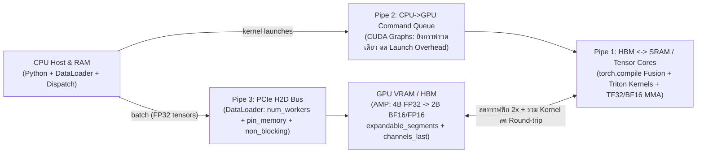

# Full Optimize Architecture & Results (`ptopt`): สถาปัตยกรรม การใช้ท่อฮาร์ดแวร์ และผลวัดจริงทุกเฟส

เอกสารนี้สรุปภาพรวม **Full Optimization Stack** ของ `kernel-pytouch-optimize` (`ptopt`) ตั้งแต่ Bootstrap Layer, Config Resolver, 9+ Runtime Passes, Custom Triton Kernels ไปจนถึง Hardening (Phase 1 → Phase 4.1) โดยอ้างอิงจากโค้ดจริงใน [`src/`](../../src/) และผลวัดจริงบน **NVIDIA L4 (`sm_89`)** และ **Local CPU**

> **ดูรายละเอียดการไล่จับคอขวดทีละรอบเพิ่มเติม:**
> - [Phase 3.1 – 3.5 Root Cause & Gains](./phase-3.1-to-3.5-root-cause-and-gains.md)
> - [Phase 3.6 – 3.7 Inference, Kernels & Tuning](./phase-3.6-to-3.7-inference-kernels-and-tuning.md)
> - [Phase 5.1 – 5.5 Kernel, Compile & Pipeline Refinements](./phase-5-kernel-compile-and-pipeline-refinements.md)

---

## 1. แก้ความเข้าใจให้ชัด: ลดขนาดตัวเลขกี่ Bit และ "ท่อ" ไหนที่เร่งได้จริง?

คำถามพบบ่อยคือ *"โปรเจกต์นี้เร็วขึ้นเพราะลดตัวเลขจาก 4 bit เหลือ 2 bit ตอนส่งจาก CPU ไป GPU ใช่ไหม?"* — คำตอบตามหลักฮาร์ดแวร์และผล Profiler จริงมี 2 ข้อสำคัญ:

1. **หน่วยคือ Byte ไม่ใช่ Bit (และไม่ใช่ Weight Quantization)**:
   - Default ของ PyTorch คือ **`FP32` = 4 bytes (32-bit)**
   - โหมด `balanced` / `aggressive` ของ `ptopt` ใช้ **Mixed Precision (`AMP`)** เป็น **`BF16` / `FP16` = 2 bytes (16-bit)** *(ลดขนาดลง 2x เพื่อเข้า Tensor Cores ไม่ได้บีบเป็น 4-bit/2-bit และเก็บ master weights/loss ใน `FP32`)*
   - ส่วน **`FP8` = 1 byte (8-bit)** มีเฉพาะโหมด opt-in พิเศษของ Inference บน `sm >= 89` ไม่เปิดโดยอัตโนมัติในโปรไฟล์มาตรฐาน
2. **คอขวดหลักกว่า 99% ในโมเดลขนาดใหญ่ไม่ได้อยู่ที่ท่อ CPU → GPU (PCIe) แต่อยู่ที่ "ท่อภายใน GPU เอง"**:
   - จาก Deep Debug ของ `transformer_lm [large]` ใน [181819_20261117-phase-3.7.txt](../../report/181819_20261117-phase-3.7.txt#L52): ช่วง `Data/Other` (ส่ง/เตรียมข้อมูลจาก CPU → GPU) กินเวลาแค่ **`0.80 ms` (0.1%)** จากทั้ง step **`792.72 ms`** ส่วนอีก **99.9%** อยู่ที่ **Forward (`262.89 ms`) + Backward (`487.27 ms`) + Optimizer (`40.66 ms`)** ภายใน GPU เอง

### สรุป 3 ท่อที่โปรเจกต์นี้เข้าไปขยายและใช้งาน

| ท่อ (Pipeline / Bus) | ปัญหาใน Vanilla PyTorch | สิ่งที่ `ptopt` ทำ | จุดที่เห็นผลชัดที่สุด (L4 `sm_89`) |
| :--- | :--- | :--- | :--- |
| **1. ท่อภายใน GPU (HBM ↔ Compute / Tensor Cores)** | รัน FP32 SIMT Cores ช้า + แยก kernel เล็ก ๆ อ่าน/เขียน VRAM ซ้ำหลายรอบ + layout `NCHW` บังคับ transpose | - `TF32` (`sm>=80`) / `BF16` AMP (ลดข้อมูลเหลือ 2 bytes + เข้า Tensor Cores) - `torch.compile` (Inductor fusion) + Custom Triton kernels (`RMSNorm`, `CrossEntropy`, `SwiGLU`) - `channels_last` สำหรับ `Conv2d` + `Fused AdamW` | - `transformer_lm [large]`: **`4.41x`** (`793.86 -> 180.14 ms`), VRAM **`-4,316.0 MB`** - `RMSNorm [large]`: **`7.39x`** (`4.374 -> 0.592 ms`, `105.8 GB/s`) |
| **2. ท่อสั่งงาน (CPU Dispatch → GPU Execution)** | งานเล็กหรือ `bs=1` GPU คำนวณเสร็จไวกว่าที่ CPU สั่งทีละคำสั่ง (`LAUNCH_BOUND`) | - `CUDA Graphs` (`mode="reduce-overhead"`) บันทึกกราฟคำสั่งแล้ว replay ใน 1 launch | - `infer_bs1_small`: `1.55 ->` **`0.49 ms` (`3.18x`)** *(เทียบ `amp+compile` ที่ได้แค่ `1.02x`)* |
| **3. ท่อขนข้อมูล (CPU RAM → PCIe → VRAM)** | `num_workers=0`, `pin_memory=False`, blocking `.to("cuda")` ทำให้ GPU รอ CPU | - Multi-worker `DataLoader` + `pin_memory=True` + `persistent_workers=True` + auto `non_blocking=True` | - `deep_mlp` โหมด `safe` (FP32 แท้ ไม่ compile): **`1.53x`** - `cnn_vision [large]` ช่วง `Data/Other`: `16.77 -> 2.40 ms` |

---

## 2. สถาปัตยกรรม Zero-Code Injection & Safety Layers

ผู้ใช้รันคำสั่งเดิมโดยไม่แก้โค้ดแม้แต่บรรทัดเดียวผ่าน `ptopt -- <command>`:

1. **Pre-launch Env & Lazy Bootstrap** ([`src/cli/main.py`](../../src/cli/main.py), [`src/hooks/bootstrap/sitecustomize.py`](../../src/hooks/bootstrap/sitecustomize.py), [`src/hooks/manager.py`](../../src/hooks/manager.py)):
   - แทรก `sitecustomize.py` เข้า `PYTHONPATH` แล้ว chain-load `sitecustomize` เดิมของระบบ (เช่น Google Colab)
   - ตั้ง allocator/thread/cache env **ก่อน** ที่ user script จะ `import torch`
   - ใช้ `_TorchImportHook` ดักรอจน user `import torch` จริงค่อยติดตั้ง passes ทั้งหมด **ครั้งเดียว (idempotent)** และ propagate ต่อไปยัง `multiprocessing` spawn workers
2. **Hardware-Aware Layered Config Resolver** ([`src/detect/`](../../src/detect/), [`src/config/rules_builtin.py`](../../src/config/rules_builtin.py), [`src/config/migrator.py`](../../src/config/migrator.py)):
   - ประเมิน config 5 ชั้น: `base -> host_arch -> gpu_arch -> vram_tier -> user_profile` (+ env/CLI overrides)
   - Phase 4.1 เพิ่ม `migrator.py` แปลง config รุ่นเก่า v0 → Schema v1 อัตโนมัติพร้อม warnings และผูก cache directory กับ `(gpu_arch, torch_version, triton_version)` ผ่าน `.ptopt_cache_meta.json` เพื่อป้องกัน stale cache ข้าม GPU/PyTorch/Triton
3. **Checkpoint & Fallback Transparency** ([`src/hooks/checkpoint_compat.py`](../../src/hooks/checkpoint_compat.py)):
   - ถอด prefix `_orig_mod.` อัตโนมัติ, normalize 4D weights/optimizer states จาก `channels_last` กลับ `contiguous_format`, และไม่ให้ `fused`/`foreach` ที่ฉีดเพิ่มรั่วลง checkpoint ทำให้โหลดข้ามไปมาได้ทุกโปรไฟล์ (Baseline ↔ `supersafe` ↔ `safe` ↔ `balanced` ↔ `aggressive`)

---

## 3. รายละเอียด Optimization Passes ทั้งหมด

| Phase | Pass / Module | กลไกหลัก & Safety Guards |
| :--- | :--- | :--- |
| **3.1a** | [`runtime_flags.py`](../../src/passes/runtime_flags.py) | เปิด `allow_tf32=True` (matmul + cuDNN) เฉพาะ `sm >= 80` (หลีกเลี่ยง `sm_75` T4), เปิด `flash_sdp` & `mem_efficient_sdp`, และ `cudnn.benchmark` (เฉพาะ `aggressive`) |
| **3.1b** | [`memory_allocator.py`](../../src/passes/memory_allocator.py) | ตั้ง `PYTORCH_CUDA_ALLOC_CONF=expandable_segments:True` ลด OOM fragmentation (`num_alloc_retries=0`), จูน `OMP_NUM_THREADS`/`torch.set_num_threads`, ตั้ง `TORCHINDUCTOR_CACHE_DIR` / `FX_GRAPH_CACHE=1` / `AUTOGRAD_CACHE=1` / `TRITON_CACHE_DIR` แบบ version-scoped |
| **3.1c** | [`channels_last.py`](../../src/passes/channels_last.py) | แปลง model + 4D input tensor เป็น `torch.channels_last` (`NHWC`) เฉพาะ CUDA `Conv2d` ที่มี spatial `>= 128x128` ขึ้นไป (และ skip MLP/small inputs เพื่อไม่เสียค่าแปลงฟรี) |
| **3.2** | [`dataloader_tune.py`](../../src/passes/dataloader_tune.py) | ปรับ `num_workers`, `pin_memory`, `persistent_workers`, `prefetch_factor=2` หลังตรวจ `/dev/shm` (`<1024MB` ปิด), `has_cuda_tensors`, และ `is_picklable_fast` พร้อม fallback `num_workers=0` เมื่อ dataset pickle ไม่ได้; auto-promote `tensor.to("cuda")` เป็น `non_blocking=True` เมื่ออยู่บน pinned memory |
| **3.3a** | [`optimizer_fusion.py`](../../src/passes/optimizer_fusion.py) | แปลง parameter generators อย่างปลอดภัยและฉีด `fused=True` (หรือ `foreach=True` เมื่อ params ไม่เข้าเกณฑ์ CUDA float) ให้ `Adam`/`AdamW`/`SGD` ลดเวลา step optimizer ของโมเดลลึกกว่า 2x–3x |
| **3.3b** | [`auto_amp.py`](../../src/passes/auto_amp.py) | เลือก `bf16` (ไม่ต้องใช้ `GradScaler`) บน `sm >= 80` และ `fp16 + GradScaler` บน `sm < 80`; มี **yield-to-user-AMP**, **LayerNorm-heavy eager skip guard**, **Functional Loss FP32 Guard** (`cross_entropy`, `nll_loss`, `bce_with_logits`, `kl_div`), และ **NaN/Inf stability watchdog** (auto-disable AMP แล้ว fallback เป็น FP32 เมื่อพบ overflow) |
| **3.5** | [`auto_compile.py`](../../src/passes/auto_compile.py) | คอมไพล์ top-level CUDA `nn.Module` in-place via `_compiled_call_impl` (ข้าม loss & CPU-only modules, yield ถ้า pre-compiled), จับ shape changes เพื่อสลับเป็น `dynamic=True` ครั้งเดียว, fallback กลับ eager หาก compile/runtime error |
| **3.6** | [`inference_opt.py`](../../src/passes/inference_opt.py) | ครอบ `torch.inference_mode()` ใน eval path เมื่อไม่ได้ขอ gradients (`is_grad_enabled`), ใช้ `mode="reduce-overhead"` (CUDA Graphs) ใน `aggressive`, และมี opt-in Fused Triton FP8 E4M3 (`PTOPT_ENABLE_FP8=1`, `sm>=89`, `m_rows >= 512`, `m_rows % 16 == 0`, lazy quantized weight cache) |
| **3.7** | [`src/kernels/`](../../src/kernels/) | Custom Triton fused kernels (`RMSNorm`, `LayerNorm`, `CrossEntropy` online-softmax, `SwiGLU`) ไม่มี `.item()` sync ใน hot path + [`registry.py`](../../src/kernels/registry.py) Compile-Aware Gate (เปิดครบใน Eager, หลีกทางให้ Inductor fuse `RMSNorm`/`LayerNorm`/`SwiGLU` เมื่อ `compile=True` คง `CrossEntropy` ไว้) |

---

## 4. Profile Matrix (4 ระดับความเสี่ยง vs ความเร็ว)

อ้างอิงจาก [`src/config/rules_builtin.py`](../../src/config/rules_builtin.py):

| Profile | Precision / Math | Passes ที่เปิดบน CUDA (`sm >= 80`) | Precision Drift (`MaxRelDiff`) | เหมาะกับงานแบบไหน |
| :--- | :--- | :--- | :--- | :--- |
| **`supersafe`** | Strict **FP32 SIMT** (`tf32=False`) | Allocator + `Fused Optimizer` + `inference_mode` | **`0.0`** (ตรงระดับ bit) | งานวิจัย/Debug/Finance ที่ต้องการผล FP32 เหมือนต้นฉบับ 100% |
| **`safe`** | **FP32 Weights + TF32 Tensor Cores** (`sm>=80`) | เหมือน `supersafe` + **TF32 Matmul/cuDNN** + `DataLoader Auto-Tune` | `~0.0` ถึง `<= 1e-3` *(ยังใช้ FP32 weights, ไม่มี AMP/compile)* | ต้องการเร่งความเร็วโดยไม่แตะ AMP/compile และคง FP32 tensors |
| **`balanced`** *(Default)* | **BF16 AMP** (`sm>=80`) / **FP16+Scaler** (`sm<80`) + TF32 | Runtime flags + Allocator + Channels-last + DataLoader + Fused Optim + **Auto-AMP** + **Compile (`default`)** + `inference_mode` | ปกติ **`7e-6` ถึง `2e-3`** *(เกณฑ์ `<= 2e-2`)* | Default ที่สมดุลสุดทั้ง Training และ Batch Inference (`3.1x–3.8x`) |
| **`aggressive`** | **BF16/FP16 AMP** + TF32 *(+Opt-in FP8 inference)* | เหมือน `balanced` + `cudnn_benchmark=True` + **Custom Triton Kernels** + **CUDA Graphs (`reduce-overhead`)** / `max-autotune` (VRAM >= 40GB) | ปกติ **`7e-6` ถึง `3e-3`** *(เกณฑ์ `<= 3e-2`)* | ต้องการรีด Latency `bs=1` (`3.2x+`) และ Large Throughput (`4.41x`) สูงสุด |

---

## 5. Benchmark Consolidation (NVIDIA L4 `sm_89`)

### 5.1 Consolidated Training & Inference Profiles ([185026_20261117-phase-3.txt](../../report/185026_20261117-phase-3.txt))

| Workload | Baseline (ms) | `safe` Speedup | `balanced` Speedup | `aggressive` Speedup | VRAM Saved (Best) |
| :--- | :---: | :---: | :---: | :---: | :---: |
| `transformer_lm` (medium) | `99.15` | `1.06x` | `3.73x` (`26.59 ms`) | **`3.85x` (`25.77 ms`)** | `-779.5 MB` |
| `cnn_vision` | `65.96` | `1.00x` | `3.10x` (`21.31 ms`) | **`3.25x` (`20.33 ms`)** | `-389.2 MB` (`balanced`) |
| `deep_mlp` | `16.39` | `1.53x` | **`1.75x` (`9.38 ms`)** | `1.74x` (`9.43 ms`) | `-95.8 MB` (`safe`) |
| `infer_runner_bs1` | `1.60` | `1.06x` | `1.04x` | **`3.26x` (`0.49 ms`)** | `+0.0` / `+0.2 MB` |
| `infer_runner_bs32` | `2.39` | `1.31x` | `1.47x` | **`2.71x` (`0.88 ms`)** | `-7.5 MB` |
| `edge_cases` (dynamic shapes + unpicklable) | `1.63` | **`1.13x`** | `0.81x` *(auto fallback)* | `0.87x` *(auto fallback)* | `-0.1 MB` |

### 5.2 Large-Scale Scaling & Micro-Kernels ([181819_20261117-phase-3.7.txt](../../report/181819_20261117-phase-3.7.txt) & [181115_20261117-phase-3.6.txt](../../report/181115_20261117-phase-3.6.txt))

- **`transformer_lm [large]` Training**: `793.86 ms ->` **`180.14 ms` (`4.41x`)**, Peak VRAM `9,174.4 MB ->` **`4,858.4 MB` (`-4,316.0 MB`)**, `MaxRelDiff = 3e-05` (`PASS`)
- **`infer_bs64_large` Throughput**: `373.94 ms ->` **`89.89 ms` (`4.16x`)** (`171.2 -> 712.0 samp/s`, VRAM `-187.5 MB`)
- **Micro-Kernels (`large`)**:
  - `RMSNorm (8192x1025)`: `4.374 ms (14.3 GB/s)` → Triton **`0.592 ms (105.8 GB/s, 7.39x vs Eager)`**
  - `CrossEntropy (8192x8192)`: `11.937 ms (20.9 GB/s)` → Triton **`3.362 ms (74.4 GB/s, 3.55x vs Eager)`**
- **Phase 4.1 3-Axis Migrate Verification** ([022049_20261118-phase-4.1.txt](../../report/022049_20261118-phase-4.1.txt)):
  - ผ่าน `4/4` suites บน Local CPU (`Unit: Config Migrator & Cache` 8 tests, `Axis 1: 5 Code Patterns`, `Axis 2: 25 Cross-Load Checkpoint Pairs`, `Axis 3: Config & Stale Cache Isolation`) — รอ user รันยืนยันบน Colab GPU

---

## 6. ข้อจำกัดจริง & ขอบเขตที่จงใจไม่ทำ (Honest Boundaries)

1. **ขอบเขต Single-GPU**: ยังไม่ได้จัดการท่อระหว่างหลาย GPU (DDP/FSDP/NCCL ring AllReduce) เพราะออกแบบให้ wrap Single-GPU Python process แบบ zero external dependencies (`dependencies = []`)
2. **DataLoader H2D ยังส่ง `FP32` และไม่บังคับ Async CUDA Stream Prefetcher**: Tensor ที่โหลดจาก CPU ยังคง dtype เดิมข้าม PCIe แล้วค่อยลดเป็น 2 bytes เมื่อเข้า `autocast` บน GPU เพื่อไม่ทำให้ user code ที่ pre-process บน CPU แตกพฤติกรรม
3. **Cold-start Compile Time**: ในงานที่รันสั้นกว่า ~40–100 steps (`transformer_lm:large` คืนทุนที่ ~42 steps, โมเดลเล็กคืนทุนช้ากว่าตาม [144108_20261117-phase-3.5.txt](../../report/144108_20261117-phase-3.5.txt#L44-L50)) ค่า Compile Step 0 อาจไม่คุ้ม ควรปิดด้วย `--no-compile` หรือรันซ้ำผ่าน warm persistent cache
4. **Dynamic Input Shapes & Unpicklable Data**: เมื่อรูปทรง input เปลี่ยนทุก step (`edge_cases`), wrapper จงใจยอมช้าลง (`0.81x–0.87x`) หรือ fallback (`dynamic=True`, `num_workers=0`) เพื่อ **ไม่ให้โปรแกรมผู้ใช้ล่มหรือค้าง**
5. **ไม่ทำ Quantization โดยพลการ**: ไม่เปลี่ยน weight เป็น `INT4`/`INT8` ในโปรไฟล์ training มาตรฐาน เพื่อรักษาความแม่นยำและพฤติกรรมการเทรนของโมเดลให้ใกล้เคียงต้นฉบับมากที่สุด
